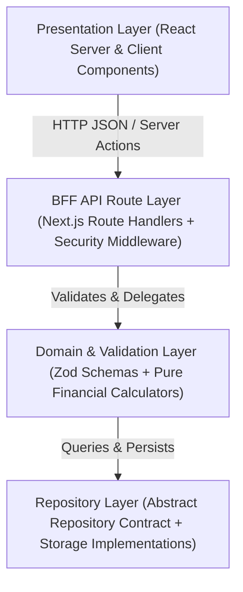

# Architecture Specification: Financial Planner

## Overview

The Financial Planner application uses a modular, four-layer architecture built on the Next.js App Router. Every layer enforces strict separation of concerns, immutable state transitions, and boundary validation.

## Architectural Layers

### 1. Presentation Layer (`src/app/`, `src/components/`)
- **Server Components**: Handle initial data fetching and layout composition with zero client-side bundle overhead where interactivity is not required.
- **Client Components**: Manage interactive financial forms, budget visualizations, and optimistic UI updates.
- **State Discipline**: Client state updates use immutable patterns only. All API responses are parsed through the standard API Response Envelope.

### 2. BFF API Route Layer (`src/app/api/`)
- **Route Handlers**: Expose RESTful endpoints (`/api/transactions`, `/api/goals`, `/api/summary`) acting as a Backend-for-Frontend (BFF).
- **Security Controls**: Enforces rate limiting, `Origin`/`Host` CSRF verification on mutating requests (`POST`, `PUT`, `PATCH`, `DELETE`), and security headers.
- **Envelope Standardization**: Wraps all outputs in `{ success, data, error, meta }` envelopes and scrubs internal stack traces before returning error responses.

### 3. Domain & Validation Layer (`src/domain/`, `src/schemas/`)
- **Boundary Validation**: Validates all incoming payloads, query parameters, and external data using strict Zod schemas before execution reaches business logic.
- **Pure Domain Logic**: Calculates net cash flow, savings progress, and 50/30/20 budget rule breakdowns using pure, side-effect-free functions that return new object instances.

### 4. Repository Layer (`src/repositories/`)
- **Repository Pattern**: Decouples domain logic from underlying storage mechanisms behind generic TypeScript interfaces (`IRepository<T, CreateInput, UpdateInput>`).
- **Swappable Implementations**: Provides an in-memory/file-backed or database-backed implementation without requiring changes to BFF route handlers or domain services.
